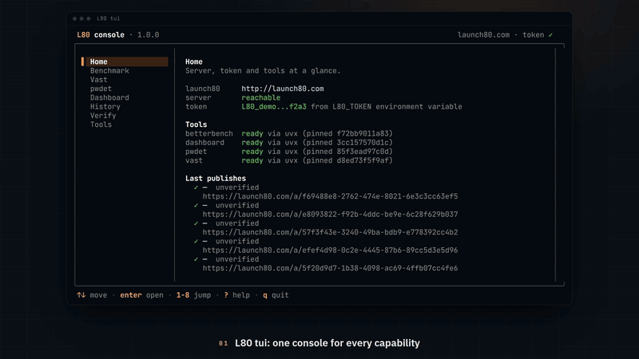
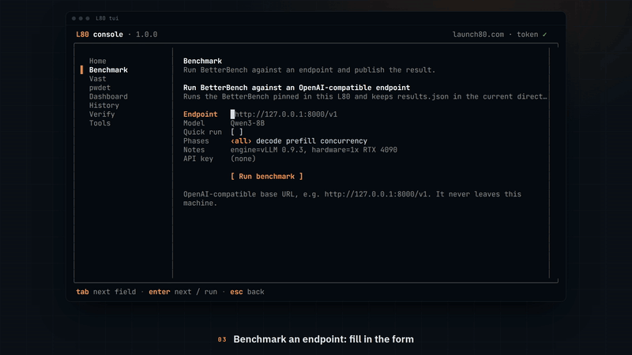
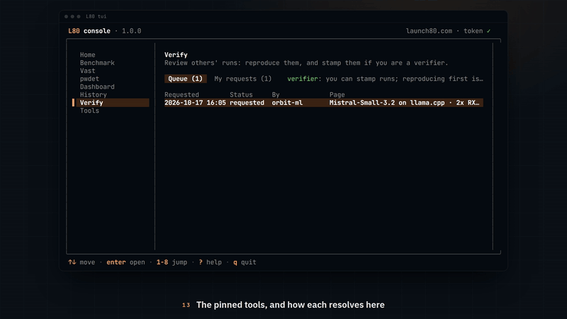
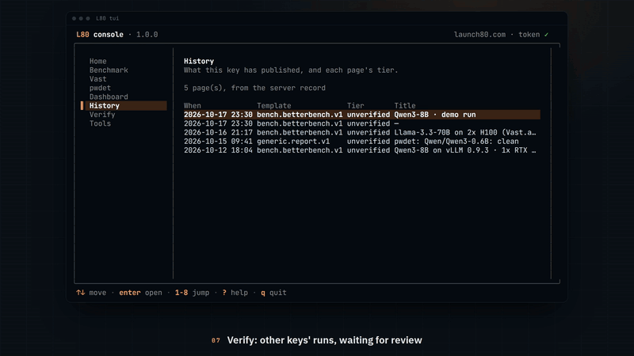
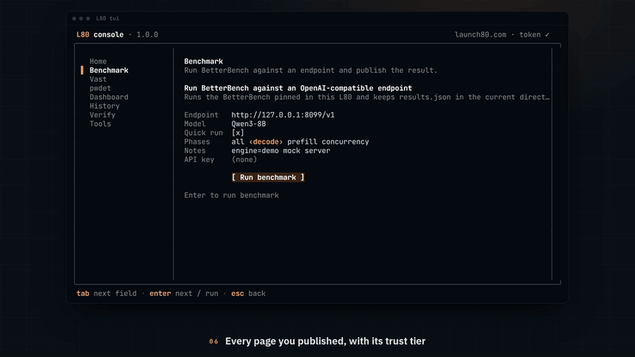
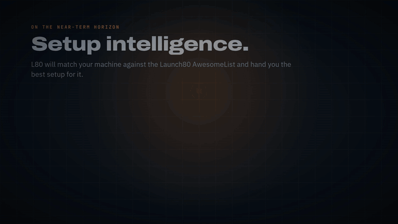
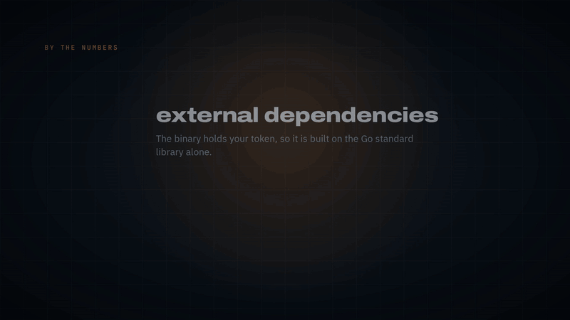

# L80 CLI

A local CLI (`L80`) plus a skill bundle that lets any LLM agent publish
structured results to launch80 and get back a shareable URL, and that puts the
Launch80 toolset behind one command: BetterBench, rented-GPU benchmarking on
Vast.ai, the Poisoned Weights Detector and a telemetry dashboard. Only
publishing needs a token; every tool is free.


## The shape of it

**Thin skill, thick CLI.** The skill is ~50 lines of markdown telling the model
which command to run. Everything network-facing, credential-handling, and
failure-prone is deterministic Go. A 7B local model behaves the same as Opus,
and the token never enters a model's context window.

**Publish data, not markup.** The CLI uploads JSON. The server validates it
against a schema it holds and renders the page from a first-party template. No
user-supplied HTML or JavaScript is ever served, which removes — rather than
mitigates — the XSS and abuse-hosting problems that come with hosting markup.

**A template registry.** Adding support for a new kind of report means writing a
schema and a template on the server. The CLI, the auth path, and the publish
pipeline are untouched.

## Install

```sh
curl -fsSL https://www.launch80.com/install.sh | sh   # prebuilt release -> ~/.local/bin/L80
```

Or build from source:

```sh
make build     # -> ./bin/L80
make install   # -> ~/.local/bin/L80
```

Then run `L80 tui`: the first time, a short onboarding checks the machine,
sets up publishing and installs L80's skills for the AI agents it finds.
`L80 onboard` runs it again.

## Let your AI agents drive L80

L80 ships skills in the open Agent Skills format (a folder with a `SKILL.md`),
so your coding agent can benchmark, rent, scan and publish for you without you
touching the console or the commands. The `l80` skill teaches the whole command
surface; `l80-test-report`, `l80-vast` and `l80-pwdet` go deep on publishing,
renting and scanning.

```sh
L80 skills targets                             # the agent harnesses found here, and what is installed
L80 skills link --target detected --all        # every skill, for every harness found
L80 skills link --target agents --all          # ~/.agents/skills: Codex, Cursor and others
L80 skills link --target claude-code --all     # ~/.claude/skills (honours CLAUDE_CONFIG_DIR)
L80 skills link --dir ./.claude/skills --all   # any directory, e.g. inside a repo
L80 skills link --target claude-code --dev \
  --from ./skills --all                        # symlink, so edits are live
L80 skills agents-md >> AGENTS.md              # for an agent that reads instructions but not skills
```

| `--target` | Directory | Read by |
|---|---|---|
| `claude-code` (`claude`) | `~/.claude/skills` | Claude Code |
| `agents` (`codex`, `cursor`) | `~/.agents/skills` | Codex, Cursor and other Agent Skills harnesses |
| `gemini` | `~/.gemini/skills` | Gemini CLI |
| `opencode` | `~/.config/opencode/skills` | OpenCode |

`L80 update` refreshes installed copies in all of them.

## The console: `L80 tui`



```sh
L80 tui
```

A full-screen console over everything below. A sidebar lists Home, then A to Z:
About, Benchmark, Dashboard, History, Onboarding, Poison Detector (pwdet),
Recommendations (coming soon), Rent (vast), Tools, Train & Tune (coming soon:
train, tune and quantize models) and Verify. Moving through it previews each screen live,
enter opens it and esc comes back; `1`-`9` jump. About has our story, the
[Discord](https://discord.gg/launch80), the
[Supporter](https://www.launch80.com/supporter) page and every command. From it you can benchmark an
endpoint, rent a GPU and benchmark it, scan weights, open the dashboard, browse
published pages and check the tools. Each screen drives the same code as the matching command, so
anything you do here you can script later. Runs stream into a scrollable log;
renting, destroying and publishing ask first, with the cost caps or the
privacy note in front of you. `vast ssh` and the dashboard take over the
terminal and hand it back when they exit.

It is built on the standard library alone (Linux and macOS). Without a
terminal it refuses rather than guessing; `L80` with no arguments still prints
the command list. `NO_COLOR` turns colour off.

## Publishing a BetterBench run



`L80 betterbench` runs [BetterBench](https://github.com/GGZ14/BetterBench)
against an OpenAI-compatible endpoint and publishes the `results.json` it
writes, as written, to the `bench.betterbench.v1` template. The server derives
every table and figure from the raw samples with a port of BetterBench's own
report code, so the page shows what the local HTML report shows.

```sh
L80 betterbench --endpoint http://host:8080/v1 --model Qwen3-8B --note engine="vLLM 0.9.3"
L80 betterbench --endpoint http://host:8080/v1 --model Qwen3-8B --quick        # 5-pass quick run
L80 betterbench --results results.json                                        # publish an existing file
L80 betterbench --results results.json --dry-run --payload-out payload.json   # inspect first
L80 betterbench --results results.json --template bench.report.v1             # summary mapping instead
```

Each L80 release pins the BetterBench it was validated against (0.6.1 in
1.0.1; `L80 tools list` shows the pin). A `betterbench` on PATH is used when
it is at least that version; otherwise L80 bootstraps the pinned commit with
`uvx` (uv caches the build). `L80_BETTERBENCH=/path/to/betterbench` overrides
both, unchecked. An endpoint behind a gateway takes `--api-key <key>` or
`L80_BETTERBENCH_API_KEY`: the key reaches BetterBench by environment, so it
never appears in the echoed command or in `results.json`. L80 switches off
BetterBench's own update check, because the pinned version is the one the
launch80 page renders. Before publishing, L80 warns about a file from an
older or newer BetterBench and about requests the server answered from its
prefix cache on a run that asked for a cold one.
`results.json` is kept in the working directory (`--out` to choose). Two
fields never leave the machine: `env.endpoint` and `env.host`; the server
refuses a file that still carries them. Flags after `--` are passed to
`betterbench run` untouched.

## Tools


L80 fronts a set of Python tools, all free to use with no token. Each is
pinned to a commit in `internal/pytool/manifest.json`, which is embedded in
the binary, so `L80 update` is also how a new version of a tool arrives.

```sh
L80 tools list              # each tool, the version this release pins, its override variable
L80 tools check             # how each tool resolves here: PATH, override, or the pinned uvx bootstrap
L80 tools prefetch          # download and build pinned tools now, not on first use
L80 tools path betterbench  # the exact command L80 would run
```



A tool is found in this order: its override variable (`L80_BETTERBENCH`,
`L80_VAST`, `L80_PWDET`, `L80_DASHBOARD`), a copy on PATH that is at least the
pinned version, then `uvx --from <pkg> @ git+<repo>@<commit> <exe>`.
Installing [uv](https://docs.astral.sh/uv/) is the only prerequisite. See
[docs/tools.md](docs/tools.md) for how pins are bumped and released.

## Rent a GPU and benchmark it: `L80 vast`

`L80 vast` runs [bbvastl80](https://github.com/launch80/BB-VAST-L80): rent a
Vast.ai GPU, serve a model on it with vLLM or llama.cpp, run BetterBench from
this machine against it, publish, and destroy the box. Every bbvastl80 command
works through it.

```sh
L80 vast doctor                                   # Vast key, SSH key, the L80 and BetterBench it will call
L80 vast spec --model Qwen/Qwen3-8B --gpu "RTX 4090" --max-dph 0.6   # write run.yaml for you
L80 vast search --spec run.yaml                   # matching offers and prices; does not bill
L80 vast run --spec run.yaml --max-hours 2        # rent, serve, benchmark, publish, tear down
L80 vast status --json                            # every run L80 knows about, and which may be billing
L80 vast destroy --run <id>                       # asks before destroying
```

L80 points bbvastl80 at this L80 for publishing and at the pinned BetterBench
for measuring, and keeps runs in `~/.local/state/L80/vast/runs`
(`BBVASTL80_RUNS_DIR` overrides). After a run it names any instance that may
still be billing. `--max-hours N` is a watchdog: when it fires, L80 stops the
run and destroys its instance. L80 never answers a confirmation prompt for you.
The Vast key comes from `VAST_API_KEY` or `~/.config/bbvastl80/credentials`.

## Check weights for tampering: `L80 pwdet`

`L80 pwdet` runs the [Poisoned Weights
Detector](https://github.com/launch80/poisoned-weights-detector) on a local
checkpoint, a Hugging Face repo, or a served endpoint.

```sh
L80 pwdet scan Qwen/Qwen3-0.6B --json                  # {"verdict": ..., "report": ...}
L80 pwdet scan ./model --profile full-static
L80 pwdet scan org/model --publish --dry-run --payload-out page.json   # inspect the page first
L80 pwdet scan org/model --publish                     # generic.report.v1 page (needs a token)
L80 pwdet checks list
```

`scan` exits 0 for clean or inconclusive, 1 for suspicious (or a pwdet
failure), and 2 for likely tampered or malicious. The published page carries
the verdict, the findings to review and the coverage. It never carries the
hostname, local paths or private endpoints: L80 removes them and refuses to
publish if any remain.

## Telemetry dashboard: `L80 dashboard`

`L80 dashboard` opens the [AI command
dashboard](https://github.com/launch80/ai-command-dashboard) terminal UI: GPU
power, temperatures, VRAM and engines, live vLLM and gateway state, per-model
performance. `L80 dashboard serve` runs the sampler and web page on
`127.0.0.1:8787`, and refuses to start a second sampler on the same port
(`--force` overrides). It is read-only and tuned for Intel Arc today; other
GPUs get a generic view.

## Verified by Launch80



A published BetterBench page is self-reported. A Launch80 verifier can stamp
it **verified**: a complete, cold-cache run, described well enough to reproduce.

```sh
# Publisher: check the run, then ask for review
L80 verify check results.json           # the checks a review applies; exit 0 if verifiable
L80 verify request <page url> --note "engine flags, how to reproduce"
L80 verify mine                         # your requests and their decisions

# Anyone with a token: look at others' requests and reproduce them
L80 verify queue
L80 verify show <id>                    # model, engine, hardware, settings, published figures
L80 verify reproduce <id> --endpoint http://127.0.0.1:8000/v1   # your run vs theirs

# Verifier keys: stamp or reject (never your own request)
L80 verify approve <id> --note "matched on 1x RTX 4090"
L80 verify reject <id> --reason "TTFT is 3x what this hardware does"
```

Every key sees the queue of other keys' requests and can reproduce them;
`reproduce` reruns BetterBench with the published settings against your own
endpoint and compares the headline figures (decode ±10%, ITL 1% low ±15%,
TTFT ±25%). Only keys Launch80 marks as verifiers can stamp. A verifier may
stamp a full run on review alone; when they reproduced the run, the comparison
goes with the stamp, and a reproduction that disagrees needs
`--accept-differences`. The
console's Verify screen does the same with `p` (reproduce), `a` (verify) and
`x` (reject).

**Quick runs can be verified too** (new in 1.1). A run with 5 to 19 passes
and a warmup (`--quick` is 5 passes after 1) is its own class. A verifier must
reproduce it before stamping, the comparison uses medians only with wider
tolerances (decode ±15%, ITL ±25%, TTFT ±40%), and `--accept-differences` does
not apply. The page's badge reads "Verified by Launch80 · quick run (N
passes)". `verify queue`, `verify mine` and History show each run's class.
Fewer than 5 passes, or no warmup, is a smoke test and cannot be verified.

A run must have at least 5 passes and a warmup, all three phases, from
BetterBench 0.6.1 or later, with no request served from the server's prefix
cache, and with `--note engine=…` and the hardware recorded. L80 also checks
that the page was published from this machine from a file that has not
changed since. The server side is specified in
[docs/verification-contract.md](docs/verification-contract.md); until
launch80 enables it, `verify request` says so and `verify check` still works.

## History



```sh
L80 history                 # newest first: time, template, URL, title
L80 history --all --json    # every artifact this key ever published, as JSON
L80 history --local         # only what this machine published, with the source file of each
```

The server is the source of truth: it lists every artifact published with the
configured key from any machine. Each successful publish is also appended to
`~/.config/L80/history.jsonl` (mode 0600), which is what `history` shows when
there is no token or no network, and the only record of which file each page
came from.

## Later: setup intelligence



Planned for a release after 1.1.0: L80 will read this machine's hardware (read-only), match it against the
[Launch80 AwesomeList](https://github.com/launch80/AwesomeList) catalog pinned
to a commit, and shortlist the community projects that fit, ranked by maturity,
verification, fit and setup friction, never by tokens per second. It hands the
plan to you or your agent and never installs anything itself. After setup,
`L80 betterbench` measures the result, and a verified run can be exported back
to the catalog. The proposed commands may change:

```sh
L80 recommend [--goal openai_api] [--priority stability] [--json]
L80 skills link --target claude-code --name l80-setup
L80 verify export <page> --awesomelist
```

See [docs/awesomelist-integration.md](docs/awesomelist-integration.md) and the
plan in [docs/setup-intelligence-plan.md](docs/setup-intelligence-plan.md).

## Update

```sh
L80 update                 # everything: the binary, the pinned tools, the installed skills
L80 update --json          # the same, as one report an agent can act on
L80 update --check         # report what is out of date; change nothing
L80 update --no-prefetch   # skip downloading pinned tools now (each downloads on first use)
```

One command brings the whole setup current, so an agent never has to work
out which piece is stale:

1. **The binary.** Downloads the latest release, verifies its checksum and
   replaces itself in place, then hands over to the new binary, so the steps
   below use the new release's pins and skills.
2. **The pinned tools.** Builds each tool's pinned commit through uvx now
   rather than on first use. A copy on PATH that `uv tool install` put there
   and that is older than the pin is upgraded to it.
3. **The skills.** Every L80 skill installed as a copy, in any agent's skills
   directory (see `L80 skills targets`), is refreshed from the binary. A `--dev` symlink is left alone, and a skill that is not installed
   stays uninstalled.
4. **Everything else is reported, not guessed at.** An override variable
   (`L80_BETTERBENCH` and friends) pointing at a tool older than the pin cannot
   be fixed from inside L80. The report names the profile line that sets it,
   e.g. `~/.bashrc:129`, and says what to do.

`--json` emits one object: the binary (`current`, `latest`,
`update_available`, `installed`, `path`), `tools[]` (`status` is current,
upgraded, stale, missing or failed, plus a `fix` when needed), `skills[]`
(current, updated, outdated, linked, not_installed), `actions[]` and
`up_to_date`. Exit 0 means nothing is left; exit 12 means `actions` lists what
needs a person. `--check` always exits 0 and puts "Run `L80 update`" first in
`actions` when the update would change something.

L80 0.4.0 and older only replace the binary, so updating from them takes two
runs of `L80 update`: the first installs this release, the second syncs.

Prebuilt releases exist for macOS and Linux on amd64 and arm64. Elsewhere,
pull and `make install`. Re-running the install script
(`curl -fsSL https://www.launch80.com/install.sh | sh`) is equivalent to `L80 update`.

## Configuration

| Variable | Meaning |
|---|---|
| `L80_API_BASE` | API base URL. Default `https://www.launch80.com`; use `http://localhost:3007` against a local server. |
| `L80_TOKEN` | Publish token, shaped `L80_<keyid>_<secret>`. |
| `L80_BETTERBENCH` | Command to run instead of the pinned BetterBench (e.g. a checkout's `.venv/bin/betterbench`). |
| `L80_BETTERBENCH_API_KEY` | Bearer key for the endpoint under test; passed by environment, never recorded. |

Falls back to `~/.config/L80/credentials.json` (mode 0600):

```json
{ "key_id": "example-fake-for-test-only", "token": "L80_example-fake-for-test-only_..." }
```

The CLI never prints a token in full — `L80 auth status` shows a masked
fragment. Do not paste a token into a chat.

## Commands

```
L80 publish <file.json> [--template <id>]      Publish a payload, print the URL
            [--json] [--dry-run]
L80 betterbench --endpoint <url> --model <m>   Run BetterBench, publish results as written
L80 betterbench --results <results.json>       Publish an existing results.json
L80 templates list [--json]                    List available templates
L80 verify check|request|status|mine           "Verified by Launch80": pre-checks and your requests
L80 verify queue|show|reproduce <id>           Review others' runs and reproduce them (any key)
L80 verify approve|reject <id>                 Stamp or reject a run (verifier keys)
L80 skills targets [--json]                    Agent harnesses found here and their L80 skills
L80 skills link --target <t>|--dir <path>      Install skills for an agent (--all, --dev, --force)
L80 skills print [name]                        Print a bundled SKILL.md (default: l80)
L80 skills agents-md                           An AGENTS.md snippet for agents without skills
L80 history [--limit N] [--json] [--local]     List the share URLs this key has published
L80 auth status                                Show the resolved endpoint and key
L80 vast <command> [args]                      Rent a GPU, serve, benchmark, publish (bbvastl80)
L80 vast spec --model <hf repo> [--max-dph N]  Write a run spec: model, GPUs, price ceiling, budget
L80 pwdet scan <model> [--json] [--publish]    Check weights for tampering
L80 dashboard [tui|serve]                      GPU and inference telemetry
L80 tools list|check|prefetch|path|run         Show, check, fetch and run the pinned Python tools
L80 tui [--onboarding]                         Full-screen console for all of the above
L80 onboard                                    Guided setup (runs by itself the first time)
L80 doctor                                     Check connectivity, config and tools
L80 update [--check] [--json]                  Update L80, its pinned tools and installed skills
L80 version
```

## Exit codes

Errors are read by a model, so each carries a code, a message, and a `remedy`
line naming the next action.

| Exit | Meaning |
|---|---|
| 0 | success |
| 1 | internal error |
| 2 | usage error |
| 3 | input file missing or unreadable |
| 4 | validation failed (`E_SCHEMA_INVALID`, `E_PAYLOAD_UNSAFE`, `E_JSON_INVALID`) |
| 5 | auth (`E_TOKEN_MISSING`, `E_UNAUTHORIZED`) |
| 6 | rate limited or over quota |
| 7 | network unreachable |
| 8 | server error |
| 9 | payload too large |
| 10 | unknown template |
| 11 | a tool L80 runs is not available here (`E_TOOL_UNAVAILABLE`) |
| 12 | `L80 update` finished, but its `actions` list something only a person can change |

`--template <id>` names the layout on the command line instead of (or as well
as) the file's `$template` field. Given both, they must agree — a disagreement
is `E_TEMPLATE_CONFLICT` (exit 2), never a silent choice.

An error code the CLI does not recognise still prints its message and remedy
verbatim and exits non-zero, so the server can add codes without a CLI release.

## Development



```sh
make test             # go test ./...
make vet
make fmt
make bump-tools       # pin tools to their local checkouts (see docs/tools.md)
make check-manifest   # confirm every pin is fetchable; SMOKE=1 also runs each with uvx
```

The binary depends on nothing outside the Go standard library, including the
console (see THIRD_PARTY_NOTICES.md for the MIT projects its design follows). That is
deliberate: this process holds a credential, so every dependency it does not
have is a supply-chain surface it cannot inherit.
